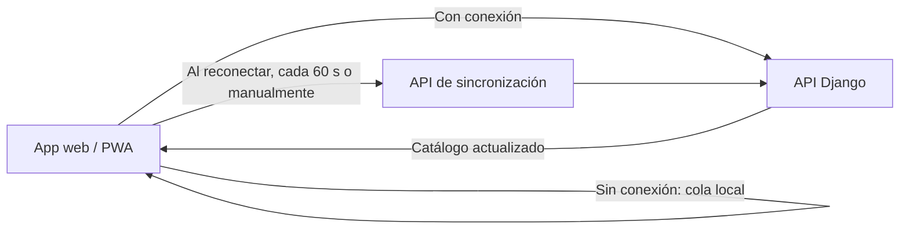

# AgroQuiriquina

**Gestión agrícola y comercial, desde la venta en terreno hasta el control de gestión.**

AgroQuiriquina es una aplicación web instalable (PWA) para centralizar operaciones de venta, clientes, inventario, trabajo en terreno, finanzas y remuneraciones. Está diseñada para equipos que pueden tener conectividad intermitente: permite registrar algunas operaciones sin conexión y sincronizarlas con el servidor cuando la red vuelve a estar disponible.

> **Estado del producto:** prototipo funcional. Antes de usarlo con información real o exponerlo a Internet, revise las recomendaciones de seguridad y operación de este documento.

## Resumen ejecutivo

| Dimensión | Descripción |
|---|---|
| Usuarios | Administración, vendedores y supervisores de terreno |
| Aplicación | Interfaz web adaptable e instalable como PWA |
| Operación offline | Ventas, clientes nuevos y registros de desempeño quedan en cola local para sincronizarse después |
| API | API REST versionada, autenticada con JWT y protegida por roles |
| Datos | SQLite para desarrollo; PostgreSQL en el despliegue Docker incluido |
| Tecnologías | Django 5, Django REST Framework, React 18, TypeScript y Vite |

## Flujos principales

### Venta y despacho

1. El vendedor consulta el catálogo y selecciona o registra un cliente.
2. Registra los productos, cantidades, pagos y, cuando corresponda, información del despacho.
3. Si está sin conexión, la venta y el cliente nuevo se guardan en la cola del dispositivo. Al volver la conexión, se envían a la API.
4. El servidor valida y guarda la venta, registra los movimientos de inventario y los pagos y crea el despacho informado.
5. Si el stock no alcanza para una venta ya realizada en terreno, la venta se conserva, el stock disponible se descuenta y queda marcada para revisión administrativa.

### Trabajo en terreno

El supervisor consulta la información disponible para su rol y registra desempeños diarios. Los registros pueden quedar pendientes en el dispositivo y se envían por lotes al recuperar conexión.

### Administración y control

La administración gestiona el acceso y los datos maestros, y consulta finanzas, cuentas por cobrar, rentabilidad e información de remuneraciones. Estos módulos requieren conexión con el servidor; el acceso a la API se valida independientemente del menú que muestre la interfaz.

### Sincronización



La app envía lotes de hasta 500 registros. Cada registro se procesa de forma independiente y utiliza un UUID para evitar duplicados cuando se reintenta un envío. La sincronización también descarga cambios del catálogo; el servidor conserva los borrados lógicos para propagar esas bajas.

## Módulos y permisos

| Módulo | Administración | Vendedor | Supervisor |
|---|:---:|:---:|:---:|
| Inicio y estado de sincronización | Sí | Sí | Sí |
| Ventas y despachos | Sí | Sí; ve sus ventas | — |
| Clientes | Sí | Sí | — |
| Bodega e inventario | Sí | Consulta según permisos del recurso | Consulta según permisos del recurso |
| Terreno y equipo | Sí | — | Sí |
| Finanzas y nómina | Sí | — | — |
| Usuarios | Sí | — | — |

Los roles se aplican también en el backend. La visibilidad del menú no sustituye la autorización de la API. Los permisos específicos pueden variar entre lectura y escritura.

## Puesta en marcha local

### Requisitos

- Python 3.10 o superior
- Node.js 20.19 o superior y npm
- Git (opcional, para clonar el repositorio)

### Instalar y preparar la base

Desde la raíz del proyecto:

```powershell
python -m venv .venv
.\.venv\Scripts\Activate.ps1
python -m pip install --upgrade pip
pip install -r requirements.txt
python manage.py migrate
python manage.py seed_demo
```

En macOS o Linux, cree el entorno con `python3 -m venv .venv` y actívelo con `source .venv/bin/activate`. Si PowerShell bloquea la activación en Windows, use CMD (`.venv\Scripts\activate.bat`) o ajuste la política de ejecución de su usuario.

El repositorio incluye migraciones; no es necesario generarlas para una instalación normal. `seed_demo` crea usuarios y datos de prueba, y puede ejecutarse más de una vez. Para personalizar la contraseña de las cuentas demo:

```bash
python manage.py seed_demo --password "UnaClaveLocalSegura"
```

El comando solo cambia las credenciales de las cuentas que crea o cuando se utiliza `--reset`. **Las cuentas y contraseñas demo son exclusivamente para desarrollo:** no las habilite en producción.

Al actualizar una instalación existente, aplique también las migraciones nuevas:

```bash
python manage.py migrate
```

En Docker, ejecute `docker compose exec web python manage.py migrate`.

### Explorar la aplicación con cuentas demo

Las cuentas de demostración usan `Cambiar123!` como contraseña inicial. Inicie sesión localmente con el perfil que corresponda:

| Usuario | Qué explorar |
|---|---|
| `admin` | Todos los módulos: ventas, movimientos, finanzas, nómina, equipo y usuarios |
| `vendedor1` | Ventas pagadas, con abono y a crédito; despachos; datos propios |
| `vendedor2` | Una venta propia para comprobar que los vendedores no ven las ventas de otros |
| `supervisor1` | Trabajadores, registros de terreno e insumos agrícolas |

La carga incluye clientes y contactos con datos completos, catálogo con un producto bajo el mínimo, movimientos de entrada/salida/ajuste, cuatro ventas, los cuatro estados de despacho y remuneraciones en borrador, aprobadas y pagadas. Una venta de demostración queda marcada para revisión por diferencia de stock. Al abrir la app o pulsar **Sincronizar ahora**, se descarga el catálogo correspondiente al rol.

Estas credenciales son públicas y débiles a propósito para facilitar pruebas locales: cambie la contraseña o elimine las cuentas demo antes de exponer la aplicación.

### Ejecutar backend y frontend

En una terminal, inicie Django:

```bash
python manage.py runserver
```

En otra terminal, ejecute Vite:

```bash
cd frontend
npm ci
npm run dev
```

Abra la URL local que informa Vite. El servidor de desarrollo reenvía las peticiones `/api/` a Django en `127.0.0.1:8000`.

Para servir la interfaz compilada desde Django, compile primero el frontend y luego inicie el backend:

```bash
cd frontend
npm ci
npm run build
cd ..
python manage.py runserver
```

La aplicación compilada queda en la raíz del servidor Django. El endpoint de salud está disponible en `/api/v1/health/`.

## Despliegue con Docker

Docker Compose levanta PostgreSQL y la aplicación web; el build incluye la compilación del frontend.

1. Copie `.env.docker.example` como `.env`.
2. Defina valores seguros para `DJANGO_SECRET_KEY` y `DB_PASSWORD`, y ajuste hosts y orígenes permitidos para su entorno.
3. Inicie los servicios:

```bash
docker compose up --build
```

4. Para cargar datos de demostración en una instalación local:

```bash
docker compose exec web python manage.py seed_demo
```

La aplicación queda disponible en `http://localhost:8000`. Los datos de PostgreSQL se conservan en el volumen `pgdata`. No use cuentas demo en un entorno accesible públicamente.

## API REST

La API tiene prefijo `/api/v1/`. Los recursos requieren autenticación salvo que se indique lo contrario.

| Área | Rutas principales |
|---|---|
| Estado y autenticación | `GET /health/` (público), `POST /auth/token/`, `POST /auth/token/refresh/`, `GET /me/` |
| Personas y acceso | `/usuarios/`, `/clientes/`, `/proveedores/`, `/trabajadores/` |
| Inventario | `/productos/`, `/insumos/`, `/movimientos/` |
| Operación comercial | `/ventas/`, `/pagos/`, `/despachos/` |
| Gestión | `/finanzas/cuentas-por-cobrar/`, `/finanzas/rentabilidad/`, `/desempenos/`, `/remuneraciones/` |
| Sincronización | `POST /sync/ventas/bulk/`, `POST /sync/clientes/bulk/`, `POST /sync/desempenos/bulk/`, `GET /sync/catalogo/` |

En la raíz del proyecto, `api_examples.http` contiene peticiones para probar con la extensión REST Client de VS Code. La documentación interactiva OpenAPI está en `/api/docs/` y el esquema en `/api/schema/`; en desarrollo está habilitada para consulta, mientras que en producción requiere un usuario administrador del sitio.

### Autenticación y contraseñas

El inicio de sesión de la aplicación es propio: `POST /api/v1/auth/token/` recibe `username` y `password` y devuelve los tokens JWT `access` y `refresh`. Las claves se derivan con PBKDF2-HMAC-SHA256 (`hashlib`), salt aleatorio y comparación segura; el backend conserva compatibilidad con las claves PBKDF2 ya guardadas. Los tokens se firman con la clave secreta configurada para Django. La renovación se realiza con `POST /api/v1/auth/token/refresh/`.

Las contraseñas nuevas o modificadas deben cumplir todas estas reglas, tanto en el formulario de usuarios como en la API:

- 8 caracteres como mínimo.
- Al menos una letra mayúscula y una minúscula.
- Al menos un número y un símbolo.

Tres intentos de inicio de sesión consecutivos con contraseña incorrecta bloquean la cuenta. Un inicio de sesión correcto reinicia el contador. Una cuenta bloqueada no puede iniciar sesión, usar sus tokens existentes ni renovarlos hasta que un usuario con rol ADMIN la desbloquee. El login responde con HTTP `423` y un mensaje que indica que debe contactar a un administrador.

Para desbloquear una cuenta desde la aplicación, vaya a **Equipo > Usuarios** y pulse **Desbloquear** en la fila correspondiente. La acción también está disponible para administradores mediante:

```http
POST /api/v1/usuarios/{id}/desbloquear/
Authorization: Bearer <token-de-administrador>
```

El desbloqueo restablece el contador de intentos fallidos a cero. La ruta de usuarios y la acción de desbloqueo requieren permisos ADMIN.

Las rutas de sincronización aceptan una lista JSON o un objeto con la clave del recurso, con un máximo de 500 registros. La respuesta incluye el resultado individual de cada elemento: `created`, `duplicate` o `error`. Si hay errores parciales, la API responde `207 Multi-Status`; los elementos correctos no requieren reenviar todo el lote.

## Operación sin conexión y límites

- El primer inicio de sesión requiere conexión. La renovación de credenciales y los módulos de finanzas y nómina también requieren conexión.
- Se guardan localmente los datos pendientes de clientes, ventas y desempeños, además de información de catálogo para consulta. La sincronización se intenta al recuperar conectividad, periódicamente (cada 60 segundos) y desde el control de estado de la aplicación.
- El almacenamiento local usa `localStorage` del navegador y **no está cifrado**. No es adecuado para dispositivos compartidos o información sensible sin controles adicionales.
- Para instalar la PWA en un dispositivo móvil se necesita HTTPS o `localhost`. En una red local, ejecute Django con `python manage.py runserver 0.0.0.0:8000` y abra la dirección de la computadora desde el dispositivo; la instalación PWA requiere además HTTPS.
- La sincronización evita duplicados mediante UUID, pero los conflictos de edición entre dispositivos y una resolución avanzada de conflictos no forman parte del alcance actual.

## Calidad y mantenimiento

Ejecute las pruebas del backend y las verificaciones del frontend antes de integrar cambios:

```bash
python manage.py test
```

```bash
cd frontend
npm run type-check
npm run build
```

Para desarrollo, SQLite se configura por defecto. El despliegue Docker usa PostgreSQL. Mantenga las migraciones versionadas junto con los cambios de modelo y aplique `python manage.py migrate` en cada entorno antes de poner una nueva versión en servicio.

## Estructura del repositorio

```text
apps/
  core/       Modelos compartidos, validación y permisos
  users/      Usuarios, roles, clientes, proveedores y trabajadores
  inventory/  Productos, insumos, stock y movimientos
  sales/      Ventas, pagos, despachos y finanzas
  hr/         Desempeños y remuneraciones
  sync/       Carga masiva y descarga incremental de catálogo
config/       URLs y configuración Django (desarrollo / producción)
docker/       Inicialización del contenedor
frontend/     PWA React, TypeScript y Vite
```

## Recomendaciones antes de producción

- Configure una clave secreta única y fuerte; no reutilice valores de ejemplo ni comparta el archivo `.env`.
- Use HTTPS detrás de un proxy correctamente configurado y active `SECURE_SSL_REDIRECT`; configure `DJANGO_ALLOWED_HOSTS`, `CORS_ALLOWED_ORIGINS` y `CSRF_TRUSTED_ORIGINS` con los dominios reales.
- No despliegue usuarios ni datos de demostración. Defina cuentas nominales, contraseñas robustas y permisos mínimos.
- Establezca copias de seguridad verificables para PostgreSQL y un procedimiento de restauración.
- Evalúe el cifrado y la política de retención de datos locales antes de operar desde dispositivos móviles compartidos.
